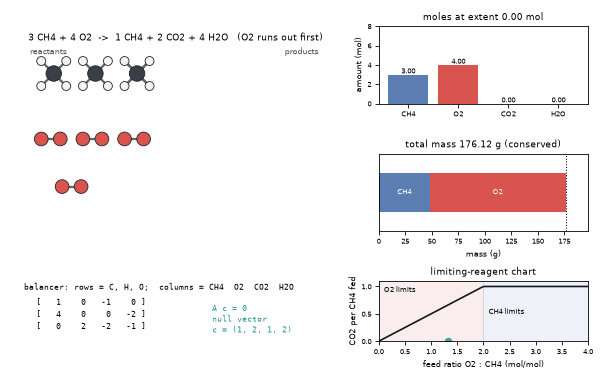
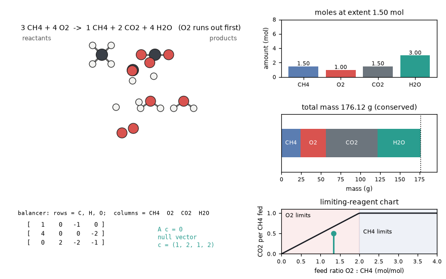
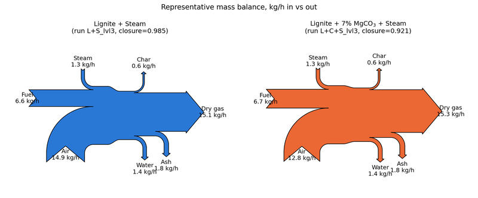
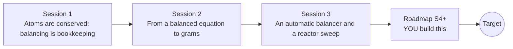

# openmole

[](https://github.com/KrunalPanchal1995/openmole/actions/workflows/ci.yml)   [](https://colab.research.google.com/github/KrunalPanchal1995/openmole/blob/main/sessions/session-01/lesson.ipynb) [](https://krunalpanchal1995.github.io/openmole/)

**Balance a reaction and work out how much reagent you need, in three sessions.**

openmole teaches chemical bookkeeping, from counting atoms to an automatic equation balancer, using only Python and a browser.

- **Start from zero.** Session 1 needs only counting; formulas such as H2O and Ca(OH)2 are explained from scratch.
- **See it move.** Every session ships a slider app that runs in the browser, with labelled bars and graphs.
- **Know you got it right.** Each session ends with a checkpoint that prints PASS or FAIL against hand calculations.
- **Build the missing half.** The repo stops at Session 3 on purpose; the roadmap shows the path to the Target.

[Target](#the-target) · [Who is this for](#who-is-this-for) · [Quick start](#quick-start) · [Sessions](#sessions) · [Roadmap](#roadmap) · [Contribute](#contribute) · [Explainer PDF](docs/explainer.pdf)

> **This repo is incomplete on purpose.** Sessions 1 to 3 are here and fully working. The finished Target below is a preview of what the community can build next. We show you the path, not the code. Sessions 4 and up are yours.

## The Target

An animated balancer for methane burning in a limited supply of oxygen. The balancer matrix is solved on screen, the atoms of 3 CH4 and 4 O2 regroup into CO2 and H2O, the mole and mass bars update as the reaction advances (total mass never changes), and a limiting-reagent chart marks where this feed sits on the yield curve. Your goal over the coming sessions: build that animated balancer yourself, for any reaction.



*Target: an animated balancer with atoms regrouping, mole and mass bars, and a limiting-reagent chart*



*A frame from the Target: the matrix solve, the atoms, the bars and the yield chart*



*A mass balance drawn as a Sankey diagram for a gasification process (what goes in comes out)*

Try it live:

- [Math Visual Studio (open the Studio and explore the maths behind the models)](https://krunalpanchal1995.github.io/studio/)

How the Target was made is shown only as a path in [promo/roadmap.md](promo/roadmap.md).

## Who is this for
**secondary school to diploma / undergraduate (levels 3-5).** Topic area: Chemistry and Materials Science.

Prerequisites:

- School arithmetic, ratios and percentages; reading a chemical formula such as H2O is explained in Session 1.
- Python 3.10 or newer; if `python --version` works, you are ready. PRIMER.md explains the rest.
- No prior chemistry, GitHub or linear algebra experience is needed (Session 3 explains the matrix idea).

New to Python? Read [PRIMER.md](PRIMER.md) first (10 minutes).

## Quick start

No installation knowledge needed. You need [Git](https://git-scm.com/downloads) and [Python 3.10+](https://www.python.org/downloads/) (Windows: tick "Add Python to PATH"). On Mac and Linux type `python3` wherever this page says `python`.

```bash
git clone https://github.com/KrunalPanchal1995/openmole.git
cd openmole
python start.py 1
```

`start.py` creates a private environment, installs what is needed and runs Session 1 with its checkpoint. Next: `python start.py 2`, `python start.py 3`, or `python start.py test` to check everything. Only a checkpoint: `python start.py check 1`.

Four lines turn the idea of Session 2 into a result (they work as they are): Save it as `try.py` and run it with `python start.py run try.py` (this uses the private environment, where NumPy is installed):

```python
import numpy as np
M = {"H": 1.008, "C": 12.011, "O": 15.999}                # g/mol
n = 16.0 / (M["C"] + 4 * M["H"])                          # moles of CH4 in 16 g
print(round(n * (M["C"] + 2 * M["O"]), 1), "g of CO2")    # CH4 + 2 O2 -> CO2 + 2 H2O: 43.9 g
```

Every session also opens in your browser with sliders (no install): [live apps](https://krunalpanchal1995.github.io/openmole/). Or use the Colab badge above for the notebook.

## Sessions

| # | Session | Model level | Time | Live app |
|---|---|---|---|---|
| 1 | [Atoms are conserved: balancing is bookkeeping](sessions/session-01/README.md) | Level 1: conceptual interactive model | 60 min | [open](https://krunalpanchal1995.github.io/openmole/session-01/) |
| 2 | [From a balanced equation to grams](sessions/session-02/README.md) | Level 2: mathematical engineering model | 75 min | [open](https://krunalpanchal1995.github.io/openmole/session-02/) |
| 3 | [An automatic balancer and a reactor sweep](sessions/session-03/README.md) | Level 3: simulation and validation | 90 min | [open](https://krunalpanchal1995.github.io/openmole/session-03/) |

Each session follows the same six steps: A real-world problem, B concept and theory, C visual explanation, D interactive simulation, E worked example and experiment, F assessment and design challenge. Each ends with `checkpoint.py`, which prints `PASS` or `FAIL` against reference numbers. Session 3 also contains the real-world mini-project: **Scale up the fertiliser recipe: hydrogen for one tonne of ammonia**.

## Architecture



| Folder or file | What is inside |
|---|---|
| `sessions/` | three sessions: README (A-F), `lesson.py`, notebook, live app, exercises, activity sheet, checkpoint |
| `promo/` | the Target: media, live links, and the roadmap (path only) |
| `docs/` | `explainer.tex` and the built `explainer.pdf` |
| `tests/` | runs every lesson and checkpoint headless |
| `start.py` | one command to set up and run anything |
| `QUALITY.md`, `RUBRIC.md` | the quality checklist and the scoring rubric |
| `.github/` | CI, PDF build, Pages deploy, issue and PR templates |

## Roadmap

| Milestone | What you will build | Difficulty |
|---|---|---|
| Session 4: Equations with many solutions | A balancer that, for nullity 2 or more, returns the extreme positive integer solutions instead of just a basis. | intermediate |
| Session 5: Titration: from volumes to a concentration | A calculator that turns titration volumes into a concentration with an uncertainty. | intermediate |
| Session 6: Recycle and purge | A steady-state mass balance of a reactor, separator and recycle stream. | advanced |
| Session 7: Equilibrium instead of complete reactions | A solver for the equilibrium extent of a reaction with a given constant. | advanced |
| Session 8: Animate the balancer | An animation of any balanced reaction with mole and mass bars. | advanced |

Full detail with a checkpoint per milestone: [promo/roadmap.md](promo/roadmap.md).

## Contribute
New to GitHub? Read [CONTRIBUTING.md](CONTRIBUTING.md); it starts from zero. Pick an issue labelled `good first issue`. Translations into Hindi, Telugu, Tamil and Malayalam are welcome.

<details>
<summary>Development</summary>

```bash
python start.py test        # runs every lesson and checkpoint
```
Lessons use `# %%` cell markers so they open as notebooks in VS Code. See [QUALITY.md](QUALITY.md) for the standard every session meets.
</details>

## License
MIT. See [LICENSE](LICENSE). Media in `promo/media` is (c) Krunal Panchal, CC BY 4.0.

## Acknowledgments
Part of the [PAN IIT OSS](https://hellofoss.tech-iitb.org/projects) open-source teaching collection, modelled on the structure of [openspline](https://github.com/openspline/openspline). Built on ideas from the Math Visual Studio at https://krunalpanchal1995.github.io/studio/.
