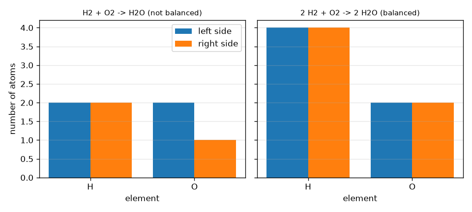
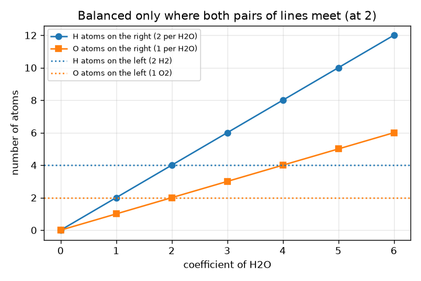

# Session 1: Atoms are conserved: balancing is bookkeeping

*Level 1 (conceptual interactive model) · about 60 minutes · openmole*

> This is a simplified educational model. It is not a validated design tool and must not be used for real structures, electrical installations, vehicles, industrial processes or medical decisions.

**Prerequisites**

- School arithmetic: counting and multiplying.
- You have read PRIMER.md and run `python start.py 1` once.

**Learning objectives.** After this session you can:

- Read a chemical formula and count the atoms of each element in it.
- Count the atoms on each side of an equation, using the coefficients.
- Decide whether an equation is balanced and say which element is off.
- Find the smallest whole-number coefficients of a small equation and scale a recipe up or down.

## A. Real-world problem
A recipe says 2 slices of bread and 1 slice of cheese make 1 sandwich. Double the sandwiches and you double every ingredient, but you never create or lose a slice. A chemical reaction is a recipe whose ingredients are atoms: when hydrogen burns in oxygen to make water, no atom appears or disappears, they only regroup. So how many hydrogen molecules and oxygen molecules do you need, and how many water molecules do you get? This session is general education about the arithmetic; do not try these reactions yourself at home.

## B. Concept and theory
A formula tells how many atoms of each element a molecule has: in H2O the small number after a symbol is the count (H2 means 2 atoms, no number means 1), and brackets multiply what is inside, so Ca(OH)2 has 1 Ca, 2 O and 2 H. In an equation, a big number in front of a formula (the coefficient) says how many molecules of that substance take part, and it multiplies every atom in the formula. Because atoms are only regrouped, the total number of atoms of each element must be the same on the left and on the right. Never change the small numbers inside a formula to balance: that changes the substance (H2O2 is not water). Only the coefficients may be changed. Multiplying every coefficient by the same number gives the same recipe made several times over.

| Symbol | Meaning | Unit |
|---|---|---|
| a, b, c | coefficients (how many H2, O2 and H2O molecules) | no unit (a count) |
| N_X | total number of atoms of element X on one side | atoms (a count) |
| x_i,X | atoms of X in one molecule of species i (the small number) | atoms per molecule |
| c_i | coefficient of species i | molecules (a count) |

**Assumptions**

- The reaction really happens as written (we only check the bookkeeping, not whether the reaction is possible or safe).
- Atoms are neither created nor destroyed (no nuclear reactions).
- Coefficients are whole numbers and the recipe is written with the smallest ones.

$$ 2\,\mathrm{H_2}+\mathrm{O_2}\;\longrightarrow\;2\,\mathrm{H_2O} $$

$$ N_X^{\text{left}}=\sum_{i\in\text{reactants}}c_i\,x_{i,X}\qquad N_X^{\text{right}}=\sum_{i\in\text{products}}c_i\,x_{i,X} $$

$$ \text{balanced}\iff N_X^{\text{left}}=N_X^{\text{right}}\ \text{for every element }X $$

## C. Visual explanation
The first figure shows atom counts as paired bars, for the unbalanced H2 + O2 -> H2O (2 O on the left, only 1 on the right) and for the balanced recipe 2 H2 + O2 -> 2 H2O, where H is 4 and 4 and O is 2 and 2. The second figure fixes the left side at 2 H2 + O2 and plots the right-hand atom counts against the coefficient of H2O: the hydrogen lines meet at a coefficient of 2 and so do the oxygen lines, which is why 2 is the only coefficient that balances both elements.

*Atom counts on the left and right: the unbalanced and the balanced recipe for water.*

*Right-hand atom counts against the coefficient of H2O: both elements match only at 2.*

## D. Interactive simulation
Run the lesson (`python start.py 1`), then open the live app: [Session 1: balance the water recipe](https://krunalpanchal1995.github.io/openmole/session-01/) (or `app.html` in this folder). Move the three coefficient sliders and watch the paired bars turn from red to green when an element is balanced, then open the graph view and see where the right-hand lines cross the flat left-hand lines.

**Challenge.** Balance H2 + O2 -> H2O with the smallest whole numbers.

## E. Worked example and experiment
**Problem.** Balance H2 + O2 -> H2O with the smallest whole numbers and show the atom counts.

1. Count the start: left has 2 H and 2 O; right has 2 H and 1 O. Hydrogen agrees, oxygen does not (2 against 1).
2. Put a 2 in front of H2O: the right now has 4 H and 2 O. Oxygen is balanced (2 and 2) but hydrogen is not (2 against 4).
3. Put a 2 in front of H2: the left now has 4 H and 2 O.
4. Check: left 4 H and 2 O, right 4 H and 2 O. The coefficients 2, 1, 2 have no common factor, so they are the smallest.

**Answer.** 2 H2 + O2 -> 2 H2O, with 4 H and 2 O on each side.

**Experiment.** Use two colours of beads or coins as hydrogen and oxygen atoms, make the pairs H-H and O-O on a table, and regroup them into H-O-H groups: you will need exactly 2 H-H pairs and 1 O-O pair to make 2 water groups with no bead left over. Do not try to burn hydrogen, it is explosive. Model versus reality: beads show the bookkeeping exactly, but real molecules also release a lot of energy and need a spark to start, which atom counting does not tell you.

## F. Assessment and design challenge
**Question type A: Conceptual.** A student balances H2 + O2 -> H2O by rewriting the product as H2O2 (so that there are 2 O on the right). Why is this wrong, and what should be done instead?

Hint

What substance is H2O2? Which numbers may be changed when balancing?

Step-by-step solution

H2O2 is hydrogen peroxide, a different substance from water, so the equation no longer describes the same reaction. Small numbers inside a formula identify the substance and must never be changed; only the coefficients in front may be changed. The correct fix is the coefficient 2 in front of H2O (and a 2 in front of H2).

**Question type B: Numerical.** Balance CH4 + O2 -> CO2 + H2O. Give the atom counts on each side.

Hint

Balance carbon first (1 and 1), then hydrogen, then oxygen last.

Step-by-step solution

CH4 + 2 O2 -> CO2 + 2 H2O. Left: 1 C, 4 H, 4 O. Right: 1 C, 4 H (2 H2O), and 2 + 2 = 4 O (one CO2 and two H2O). The counts agree for every element. Units: all counts are numbers of atoms.

**Question type C: Graph and simulation interpretation.** In the graph view with a = 2 and b = 1, at which coefficient of H2O do the right-hand H and O lines meet the flat left-hand lines? What happens at c = 1 and c = 3?

Hint

Find where the H line (2c) reaches 4 and where the O line (c) reaches 2.

Step-by-step solution

They meet at c = 2: H right is 2c = 4 = H left and O right is c = 2 = O left. At c = 1 the right side has only 2 H and 1 O, too few; at c = 3 it has 6 H and 3 O, too many. Both elements are balanced at the same single value, which is why a solution exists.

**Question type D: Design and optimisation challenge.** Design: you want 12 molecules of water. How many H2 and O2 molecules do you need? If you only have 20 H2 and 7 O2 molecules, how many water molecules can you make at most and what is left over?

Hint

The recipe 2 : 1 : 2 is repeated 6 times for 12 waters. For the second part, see which ingredient runs out first.

Step-by-step solution

12 waters is 6 times the recipe, so 12 H2 and 6 O2. With 7 O2 you can make at most 14 water molecules, which needs 14 H2. Hydrogen (20) is enough, so oxygen runs out first: 14 H2O are made and 6 H2 are left over. Assumption: the reaction goes to completion. The ingredient that runs out first is called the limiting reagent (Session 2).

Score yourself with [RUBRIC.md](../../RUBRIC.md). Print the [activity sheet](activity_sheet.md) to work on paper.

## Common misconceptions
| Common misconception | What is actually true |
|---|---|
| To balance an equation, change the small numbers in the formulas. | The small numbers define the substance. Only the big numbers in front (the coefficients) may be changed. |
| The coefficient only multiplies the first atom of the formula. | A coefficient multiplies the whole formula: 2 H2O means 4 H and 2 O. |
| The number of molecules must be the same on both sides. | It is the atoms of each element that must match; here 3 molecules (2 H2 + O2) make 2 molecules (2 H2O). |
| If one element is balanced, the equation is balanced. | Every element must match; in H2 + O2 -> H2O the hydrogen is fine but the oxygen is not. |

## Glossary
- **reactant**: a substance that is used up in a reaction (left of the arrow)
- **product**: a substance that is made in a reaction (right of the arrow)
- **coefficient**: the big number in front of a formula; how many molecules take part
- **subscript**: the small number after a symbol inside a formula; atoms of that element per molecule
- **balanced equation**: an equation with the same number of atoms of each element on both sides

## Finish
1. Do the three coding tasks in [exercises.md](exercises.md).
2. Run `python start.py 1` again after your changes. It ends with the checkpoint; when it prints `PASS`, you are done. (Checkpoint only: `python start.py check 1`.)

Next: [Session 2](../session-02/README.md)
