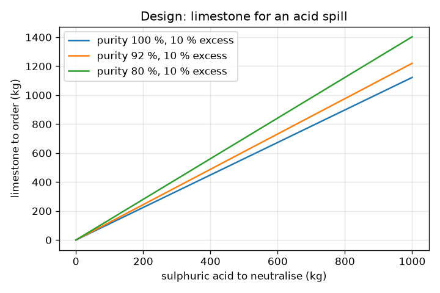
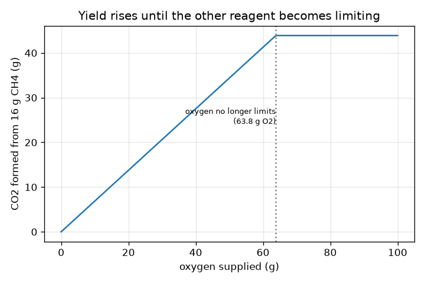

# Session 2: From a balanced equation to grams

*Level 2 (mathematical engineering model) · about 75 minutes · openmole*

> This is a simplified educational model. It is not a validated design tool and must not be used for real structures, electrical installations, vehicles, industrial processes or medical decisions.

**Prerequisites**

- Session 1: atoms are conserved and equations balance.
- Ratios, percentages and unit conversion (g, kg, L).

**Learning objectives.** After this session you can:

- Compute a molar mass from a table of atomic masses and convert between grams, moles and molecules.
- Use the coefficients of a balanced equation as mole ratios to convert the mass of one substance to another.
- Find the limiting reagent and compute theoretical and percent yield.
- Compute molarity and solve a design problem: how much limestone neutralises a given acid quantity.

## A. Real-world problem
A truck spills 500 kg of sulphuric acid. Limestone (calcium carbonate) neutralises it, but a shop sells limestone by the kilogram, not by the molecule. How many kilograms do you order, given that the limestone is not pure and you want a safety margin? And when you burn 16 g of methane (natural gas), how many grams of carbon dioxide leave the flame? The mole is the bridge between the molecules in the equation and the grams on the scale. This is general education with textbook values; real spills need trained responders, data sheets and local rules.

## B. Concept and theory
The molar mass M of a substance is the mass of one mole of it in g/mol, found by adding the atomic masses of all atoms in the formula: M(H2O) = 2 * 1.008 + 15.999 = 18.015 g/mol. A mole is 6.022e23 entities (Avogadro's number N_A). The amount of substance is n = m / M. In a balanced equation the coefficients are mole ratios: for CH4 + 2 O2 -> CO2 + 2 H2O one mole of CH4 gives one mole of CO2 and uses two moles of O2. To convert grams of A to grams of B: grams to moles of A, multiply by (coefficient of B / coefficient of A), moles to grams of B. Reagents are rarely supplied in exact ratio. For each reactant divide its moles by its coefficient; the smallest value is the extent xi (how many times the recipe runs) and that reactant is the limiting reagent; the others are in excess. The theoretical yield of a product is xi times its coefficient times its molar mass, and the percent yield compares what you actually get. For solutions, molarity c = n / V is moles of solute per litre.

| Symbol | Meaning | Unit |
|---|---|---|
| m | mass of a sample | g |
| M | molar mass | g/mol |
| n | amount of substance | mol |
| N_A | Avogadro's number | 1/mol (6.022e23) |
| nu_i | stoichiometric coefficient of species i | no unit |
| xi | extent: how many times the recipe runs (smallest n_i / nu_i) | mol |
| eta | percent yield, 100 * actual / theoretical | percent |
| c, V | molarity and solution volume | mol/L, L |

**Assumptions**

- Atomic masses are rounded textbook values (H 1.008, C 12.011, N 14.007, O 15.999, Na 22.990, Cl 35.45, S 32.06, Ca 40.078, plus Fe 55.845 and Al 26.982).
- The reaction runs to completion in the ratios of the balanced equation, with no side reactions.
- Limestone purity is a mass fraction of CaCO3 and the impurities do not react with the acid.

$$ n=\frac{m}{M}\qquad N=n\,N_A\qquad N_A=6.022\times10^{23}\ \mathrm{mol^{-1}} $$

$$ m_B=\frac{m_A}{M_A}\cdot\frac{\nu_B}{\nu_A}\cdot M_B $$

$$ \xi=\min_i\frac{n_i}{\nu_i}\qquad m_{\text{theory}}=\xi\,\nu_{\text{prod}}\,M_{\text{prod}} $$

$$ \eta=100\,\frac{m_{\text{actual}}}{m_{\text{theory}}}\qquad c=\frac{n}{V} $$

$$ \mathrm{CaCO_3+H_2SO_4\rightarrow CaSO_4+H_2O+CO_2} $$

## C. Visual explanation
The first figure plots the CO2 formed from 16 g of methane against the oxygen supplied: a straight rising line (slope 0.688 g of CO2 per gram of O2) while oxygen is limiting, then a flat plateau at 43.89 g once there is 63.8 g of oxygen and methane becomes the limit. The second figure plots the limestone to order against the acid to neutralise for three purities (each with a 10 percent excess): straight lines through the origin, steeper for dirtier limestone. The app bars show moles supplied and used, with the limiting reagent labelled.

*Limestone to order against acid to neutralise, for three purities with 10 percent excess.*

*CO2 from 16 g of CH4 against the oxygen supplied: a rise, then a plateau where methane limits.*

## D. Interactive simulation
Run the lesson (`python start.py 2`), then open the live app: [Session 2: methane in limited oxygen](https://krunalpanchal1995.github.io/openmole/session-02/) (or `app.html` in this folder). Change the methane and oxygen masses and watch the limiting reagent and the CO2 yield change, then open the yield graph and find the kink; lower the percent yield and see actual CO2 drop below the theoretical ceiling.

**Challenge.** Make oxygen the limiting reagent while still producing at least 30 g of CO2.

## E. Worked example and experiment
**Problem.** How many grams of CO2 are produced when 16 g of CH4 burns completely in CH4 + 2 O2 -> CO2 + 2 H2O? Check that mass is conserved.

1. M(CH4) = 12.011 + 4 * 1.008 = 16.043 g/mol, so n(CH4) = 16 / 16.043 = 0.9973 mol.
2. The coefficients of CH4 and CO2 are both 1, so n(CO2) = 0.9973 mol.
3. M(CO2) = 12.011 + 2 * 15.999 = 44.009 g/mol, so m(CO2) = 0.9973 * 44.009 = 43.89 g.
4. Mass check: O2 used = 2 * 0.9973 * 31.998 = 63.82 g and H2O formed = 2 * 0.9973 * 18.015 = 35.93 g. In: 16 + 63.82 = 79.82 g. Out: 43.89 + 35.93 = 79.82 g.

**Answer.** 16 g of CH4 gives 43.9 g of CO2 (43.89 g with these atomic masses; rounding M(CH4) to 16.0 gives about 44.0 g). Mass in equals mass out: 79.82 g.

**Experiment.** Burn a small candle on a kitchen scale under supervision, or weigh baking soda and vinegar in an open cup before and after: the visible mass seems to fall because the CO2 gas escapes. Close the container (a bottle with a balloon, balloon sealed to the neck) and the total mass stays the same on the scale. Model versus reality: the model assumes complete reaction and no losses; real flames also make soot and carbon monoxide and a scale reads to about 0.1 g, so expect the real yield to be a little under the theoretical one.

## F. Assessment and design challenge
**Question type A: Conceptual.** In CH4 + 2 O2 -> CO2 + 2 H2O the coefficients are 1 : 2 : 1 : 2. Does 1 g of CH4 need 2 g of O2? Explain.

Hint

Are the coefficients mole ratios or mass ratios? Compare M(CH4) and M(O2).

Step-by-step solution

No. The coefficients are ratios of moles (molecules), not of grams. One mole of CH4 (16.043 g) needs two moles of O2 (63.996 g), so 1 g of CH4 needs about 3.99 g of O2. Convert to moles first, apply the ratio, then convert back to grams.

**Question type B: Numerical.** How many grams of NaCl do you need for 0.5 L of a 0.10 mol/L solution? How many NaCl formula units is that?

Hint

n = c * V, then m = n * M. M(NaCl) = 22.990 + 35.45.

Step-by-step solution

n = 0.10 * 0.5 = 0.050 mol. M(NaCl) = 58.44 g/mol, so m = 0.050 * 58.44 = 2.922 g (about 2.9 g). Formula units = 0.050 * 6.022e23 = 3.0e22. Check: 2.922 / 58.44 = 0.050 mol.

**Question type C: Graph and simulation interpretation.** In the yield graph (16 g CH4), what is the slope of the rising part and where does the kink occur? Why is the graph flat afterwards?

Hint

The slope is the CO2 mass per gram of O2 before methane is used up: M(CO2) / (2 M(O2)).

Step-by-step solution

Slope = 44.009 / (2 * 31.998) = 0.688 g of CO2 per g of O2. The kink is at 63.8 g of O2 (2 mol per mol CH4 times 0.9973 mol * 31.998 g/mol). Beyond it methane is the limiting reagent, so extra oxygen cannot make more CO2: the plateau is 43.89 g.

**Question type D: Design and optimisation challenge.** Design: 250 kg of sulphuric acid must be neutralised with limestone that is 90 percent CaCO3, with a 15 percent safety excess, in 25 kg bags. How many bags? How much CO2 is released at least? State the balanced equation.

Hint

CaCO3 + H2SO4 -> CaSO4 + H2O + CO2 is 1 : 1. Pure CaCO3 mass = acid mass * M(CaCO3) / M(H2SO4); then apply the excess and divide by the purity.

Step-by-step solution

M(H2SO4) = 98.072 g/mol and M(CaCO3) = 100.086 g/mol. Pure CaCO3 = 250 * 100.086 / 98.072 = 255.1 kg. With 15 percent excess: 293.4 kg of CaCO3; at 90 percent purity this is 326.0 kg of limestone. 326.0 / 25 = 13.04, so 14 bags (350 kg). CO2 from the acid actually neutralised: 250 / 98.072 * 44.009 = 112.2 kg (roughly 60 cubic metres of gas, so work outdoors and keep the area ventilated). Assumptions: complete reaction, inert impurities; the excess limestone does not react further. Trade-off: more excess is safer for the spill but costs more and leaves more solid to dispose of.

Score yourself with [RUBRIC.md](../../RUBRIC.md). Print the [activity sheet](activity_sheet.md) to work on paper.

## Common misconceptions
| Common misconception | What is actually true |
|---|---|
| The coefficients in the equation are ratios of masses. | They are ratios of moles (molecules). Convert grams to moles with n = m / M before using them. |
| The reagent present in the smaller mass is the limiting reagent. | The limiting reagent has the smallest n / coefficient. 40 g of CH4 is more moles than 50 g of O2 needs: oxygen limits. |
| A mole is a mass. | A mole is a count, 6.022e23 entities. Its mass depends on the substance (18.015 g for water, 44.009 g for CO2). |
| Percent yield above 100 percent means a great reaction. | It usually means the product is wet or impure, or a measurement error; actual yield cannot exceed the theoretical yield. |

## Glossary
- **mole**: the amount of substance that contains 6.022e23 entities (atoms, molecules, formula units)
- **molar mass**: mass of one mole of a substance, in g/mol
- **limiting reagent**: the reactant that runs out first and sets how much product forms
- **theoretical yield**: the product mass if the limiting reagent were fully used
- **percent yield**: 100 times actual product divided by theoretical product
- **molarity**: moles of solute per litre of solution, mol/L

## Finish
1. Do the three coding tasks in [exercises.md](exercises.md).
2. Run `python start.py 2` again after your changes. It ends with the checkpoint; when it prints `PASS`, you are done. (Checkpoint only: `python start.py check 2`.)

Next: [Session 3](../session-03/README.md)
