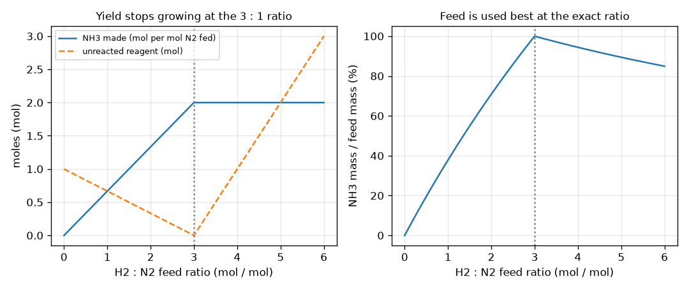
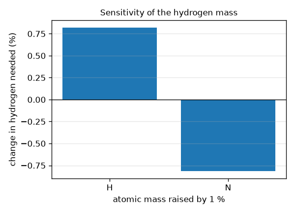

# Session 3: An automatic balancer and a reactor sweep

*Level 3 (simulation and validation) · about 90 minutes · openmole*

> This is a simplified educational model. It is not a validated design tool and must not be used for real structures, electrical installations, vehicles, industrial processes or medical decisions.

**Prerequisites**

- Session 1: balanced equations.
- Session 2: moles, limiting reagent and yield.
- Basic idea of a matrix times a vector (explained in Section B).

**Learning objectives.** After this session you can:

- Write a reaction as an element-by-species matrix A and explain why the coefficients solve A c = 0.
- Find integer coefficients as the null space of A with numpy and fractions.Fraction, and validate them on known reactions.
- Check conservation of atoms, mass and charge, including for an ionic equation.
- Sweep a reagent feed ratio, measure the sensitivity of the answer to the molar-mass table, and recognise equations with no solution or many solutions.

## A. Real-world problem
A fertiliser plant turns nitrogen and hydrogen into ammonia. Before buying gas the engineer needs the exact ratio and the answer to one question: how much hydrogen does a tonne of ammonia need? Balancing by trial works for water, but a real reaction can have ten species, and some equations cannot be balanced at all or can be balanced in several ways. Atom conservation is a set of linear equations, so a computer can balance anything. This session is general education about an idealised model, not a plant design.

## B. Concept and theory
Take every species as a column and every element as a row. The entry is the number of atoms of that element in the species, with a plus sign for reactants and a minus sign for products. For ionic equations add one more row with the charge of each species (also signed). With coefficients c in a column vector, atom and charge conservation say A c = 0. The set of all such c is the null space of A; its dimension (the nullity) tells how many independent ways there are to balance. Nullity 1 gives a unique recipe up to a common factor; nullity 0 means the species cannot be balanced; nullity 2 or more means several independent recipes (not a unique answer). We find the null space with the singular value decomposition: right singular vectors whose singular value is zero span it. A unit-length vector is not a recipe, so we divide by the smallest non-zero entry, rationalise each entry with Fraction.limit_denominator, multiply by the common denominator, divide by the greatest common divisor and make the signs positive, then verify A c = 0 exactly with integers. A physical reaction needs every coefficient to be positive. For a reactor, the feed ratio decides which reagent limits: with 1 mol of N2 and r mol of H2 the extent is min(1, r/3), and mass is conserved however the reagents are mixed.

| Symbol | Meaning | Unit |
|---|---|---|
| A | element-by-species matrix (reactants +, products -) | atoms (counts) |
| c | vector of coefficients | no unit |
| k | nullity: dimension of the null space of A | no unit |
| r | feed ratio n(H2) / n(N2) | mol/mol |
| xi | extent of reaction | mol |
| conversion | fraction of the possible extent achieved | no unit (0 to 1) |
| S | sensitivity: percent change of the answer for 1 percent change of an atomic mass | percent per percent |

**Assumptions**

- Atom conservation is exact; electrons are ignored in the mass balance (their mass is negligible).
- Reactions go to the extent allowed by the limiting reagent, times a conversion factor; no equilibrium, kinetics or recycle.
- The atomic-mass table is rounded; real certified values differ in the last digits.
- Educational model only; plant design needs reaction engineering, energy balances and safety review.

$$ A_{e,j}=\pm\,(\text{atoms of element }e\text{ in species }j)\qquad A_{q,j}=\pm\,(\text{charge of species }j) $$

$$ A\,\mathbf c=\mathbf 0\qquad \text{nullity }k=n_{\text{species}}-\operatorname{rank}A $$

$$ A=U\Sigma V^{\mathsf T}\;\Rightarrow\;\text{null space}=\operatorname{span}\{\mathbf v_j:\sigma_j\approx 0\} $$

$$ \xi=\min\!\left(n_{\mathrm{N_2}},\tfrac{1}{3}n_{\mathrm{H_2}}\right)\qquad n_{\mathrm{NH_3}}=2\xi $$

$$ m_{\mathrm{H_2}}=\frac{3\,M_{\mathrm{H_2}}}{2\,M_{\mathrm{NH_3}}}\,m_{\mathrm{NH_3}} $$

## C. Visual explanation
The first figure sweeps the H2 to N2 feed ratio from 0 to 6 for 1 mol of N2. Left: ammonia rises in a straight line until the ratio is 3 (2 mol made) and then stays flat, while the unreacted reagent falls to zero at 3 and rises again as hydrogen is wasted. Right: ammonia mass divided by feed mass climbs to 100 percent exactly at ratio 3, because all the feed is converted and mass is conserved, and falls beyond it. The second figure shows the sensitivity: raising the atomic mass of hydrogen by 1 percent raises the hydrogen needed for a tonne of ammonia by 0.82 percent, and raising nitrogen by 1 percent lowers it by 0.82 percent.

*Ammonia made and reagent wasted against the H2 to N2 feed ratio, and the ammonia mass over feed mass.*

*Percent change of the hydrogen needed when an atomic mass is raised by 1 percent.*

## D. Interactive simulation
Run the lesson (`python start.py 3`), then open the live app: [Session 3: an ammonia reactor](https://krunalpanchal1995.github.io/openmole/session-03/) (or `app.html` in this folder). Change the nitrogen fed, the H2 : N2 ratio and the conversion; watch the limiting reagent switch at a ratio of 3 and the red waste bars appear on either side, then use the graph view to find the ratio that wastes least.

**Challenge.** Make at least 18 mol of ammonia with no more than 2 mol of reagent left over.

## E. Worked example and experiment
**Problem.** Balance Fe2O3 + Al -> Al2O3 + Fe with the null-space method and verify the result.

1. Species columns in order: Fe2O3, Al, Al2O3, Fe. Rows in alphabetical order: Al, Fe, O. Reactants plus, products minus: A = [[0, 1, -2, 0], [2, 0, 0, -1], [3, 0, -3, 0]].
2. Row Al: b - 2c = 0. Row Fe: 2a - d = 0. Row O: 3a - 3c = 0. So c = a, b = 2a, d = 2a, one free number a, hence nullity 1 (3 independent rows, 4 columns).
3. Take a = 1: the null vector is (1, 2, 1, 2). The numpy SVD returns a unit-length multiple of it, (0.31, 0.63, 0.31, 0.63), which rationalises to the same integers.
4. Check by integers: A c = (0 + 2 - 2, 2 + 0 - 0 - 2, 3 + 0 - 3 - 0) = (0, 0, 0). Check by mass: 159.687 + 2 * 26.982 = 213.651 g and 101.961 + 2 * 55.845 = 213.651 g.

**Answer.** Fe2O3 + 2 Al -> Al2O3 + 2 Fe; the nullity is 1 and A c = 0 exactly; total mass 213.651 g per mole of reaction on each side.

**Experiment.** The thermite reaction is this equation, but it is violently exothermic and must never be attempted outside a professional setting. A safe hands-on comparison: weigh 10 g of baking soda and 20 mL of vinegar in a closed bottle with a balloon, note the total mass before and after (it should not change) and compare the balloon volume with the CO2 predicted by NaHCO3 + CH3COOH -> CH3COONa + H2O + CO2. Model versus reality: the balancer proves atoms and mass are conserved, but not that the reaction is fast, complete or safe, and it ignores energy.

## Real-world application and mini-project: Scale up the fertiliser recipe: hydrogen for one tonne of ammonia
Ammonia for fertiliser is made by N2 + 3 H2 -> 2 NH3. A plant wants to make 1 tonne (1000 kg) of NH3. Use the Session 3 balancer to get the coefficients, then compute the hydrogen and nitrogen needed, check that the mass balance closes, and repeat the hydrogen estimate if only 90 percent of the possible reaction is achieved. Finally report how much the answer moves if the atomic mass of hydrogen in your table is 1 percent too high.

**Deliverable:** A script that prints the balanced equation, the kilograms of H2 and N2 for 1000 kg of NH3, the mass balance (inputs minus outputs), the hydrogen needed at 90 percent yield, and the percent change of the hydrogen mass when M(H) is raised by 1 percent.

**Success looks like:** The hydrogen is 177.6 kg and the nitrogen 822.4 kg (sum 1000.0 kg, mass balance closed to 1e-9), the 90 percent case needs 197.3 kg, and the 1 percent change in M(H) moves the hydrogen mass by about +0.82 percent.

## F. Assessment and design challenge
**Question type A: Conceptual.** Why does a unique balanced equation correspond to a null space of dimension exactly 1? What would nullity 0 and nullity 2 mean?

Hint

Count free numbers: how many coefficients can you choose before the rest are fixed?

Step-by-step solution

Nullity is the number of free numbers left after all conservation equations are used. With nullity 1 you choose one number (the overall scale) and everything else follows, so the recipe is unique up to scaling by a common factor. Nullity 0 means only c = 0 satisfies the equations: the species cannot conserve every element (for example H2 + O2 -> NaCl). Nullity 2 means two independent recipes exist and any positive combination also balances, so the equation is not uniquely balanced (for example H2 + O2 -> H2O + H2O2).

**Question type B: Numerical.** How many kilograms of hydrogen are needed for 250 kg of ammonia, assuming complete reaction? Check with a mass balance.

Hint

m(H2) = 1.5 * M(H2) / M(NH3) * m(NH3) with M(H2) = 2.016 and M(NH3) = 17.031 g/mol.

Step-by-step solution

m(H2) = 1.5 * 2.016 / 17.031 * 250 = 44.39 kg. Nitrogen: 28.014 / (2 * 17.031) * 250 = 205.6 kg. Check: 44.39 + 205.6 = 250.0 kg. Units: kg, since the molar-mass ratio has no unit.

**Question type C: Graph and simulation interpretation.** In the feed-ratio graph (left), why does the NH3 line become flat at ratio 3 while the red waste curve has a V shape with its minimum at 3?

Hint

Which reagent limits on each side of 3?

Step-by-step solution

Below 3, hydrogen limits: every extra mole of H2 makes 2/3 mol more NH3 (the rising line) and the leftover is nitrogen, which shrinks. Above 3, nitrogen limits: the NH3 is fixed at 2 mol and every extra H2 is waste, so the waste grows. At exactly 3 nothing is left over, so waste is 0, the minimum of the V.

**Question type D: Design and optimisation challenge.** Design: a plant feeds 100 kmol/h of N2, but the hydrogen meter is only good to plus or minus 5 percent. Choose the hydrogen set-point ratio so that yield never falls below 99.5 percent of the possible ammonia, and report the worst-case hydrogen waste.

Hint

The lowest actual ratio is set-point * 0.95; yield is min(1, r / 3). Then the highest ratio is set-point * 1.05.

Step-by-step solution

We need 0.95 * set-point / 3 >= 0.995, so set-point >= 3.142; take 3.15. Lowest ratio = 2.9925, yield 99.75 percent of the possible. Highest ratio = 3.3075, so 0.3075 mol of H2 per mol N2 is wasted, about 9.3 percent of the fed hydrogen. Trade-off: tighter metering lets the set-point move towards 3 and waste less hydrogen; a lower set-point wastes less but risks lost yield. Assumption: complete conversion and no recycle (a real plant recycles unreacted gas).

Score yourself with [RUBRIC.md](../../RUBRIC.md). Print the [activity sheet](activity_sheet.md) to work on paper.

## Common misconceptions
| Common misconception | What is actually true |
|---|---|
| If the code returns numbers like 0.31 and 0.63 that is the balanced equation. | The null vector is only defined up to a scale; it must be turned into the smallest positive whole numbers and checked with A c = 0. |
| Every equation has exactly one balanced form. | Some have no solution (nullity 0) and some have several independent ones (nullity 2 or more); the code must report this instead of guessing. |
| Adding more of one reagent always gives more product. | Only until the other reagent becomes limiting; beyond that the extra is wasted. |
| Charge only matters for ions, so ionic equations balance with atoms alone. | Atoms alone can leave the equation under-determined; the charge row removes the freedom (the permanganate example drops from nullity 2 to 1). |

## Glossary
- **null space**: all vectors c with A c = 0; here all sets of coefficients that conserve atoms and charge
- **nullity**: the dimension of the null space; the number of independent ways to balance
- **rank**: number of independent rows of a matrix
- **SVD**: singular value decomposition, a matrix factorisation that exposes the null space
- **extent of reaction**: how many times the recipe runs, in moles
- **conversion**: the fraction of the possible extent that actually happens

## Finish
1. Do the three coding tasks in [exercises.md](exercises.md).
2. Run `python start.py 3` again after your changes. It ends with the checkpoint; when it prints `PASS`, you are done. (Checkpoint only: `python start.py check 3`.)

Next: the [roadmap](../../promo/roadmap.md). Session 4 is yours to build.
